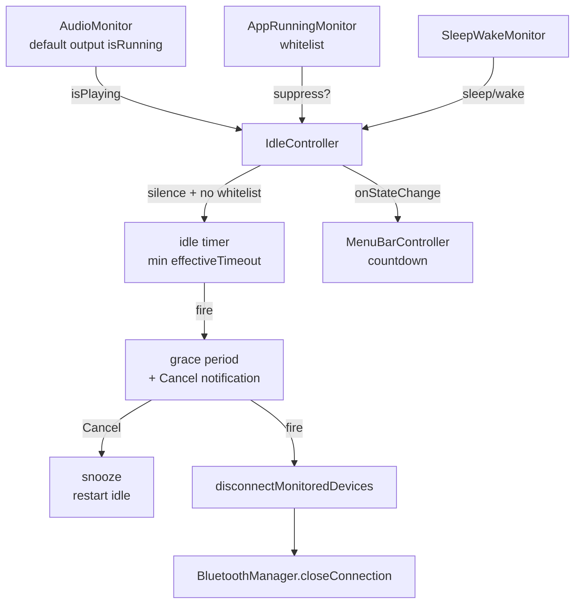

# Architecture — mental model

> A single menu-bar process (`.accessory`). Monitors feed signals into a central
> `IdleController`, which drives the idle → grace → disconnect state machine.

## System invariants

1. **Single decision point**: only [[module-orchestration]] (`IdleController`) decides
   to disconnect. Monitors only report signals, they never disconnect on their own.
2. **Audio = default output**: silence detection only applies to `defaultOutputDevice`
   (`AudioMonitor.swift`). Other outputs are invisible.
3. **Disconnect by address**: the device identifier is the BT address string,
   not an object; consistent across `BluetoothManager` and `SettingsStore`.
4. **State in memory, settings on disk**: timer state lives only in `IdleController`;
   only `GlobalSettings` → `settings.json` (debounced) is persistent.
5. **The UI is passive**: `MenuBarController`/`SettingsWindow` read state and react to
   `onStateChange`; they hold no idle logic of their own.

## Request flow (Mermaid)

## Diagnostic table

| Symptom | Check in order |
|---|---|
| Does not disconnect after the timeout | 1) is `Idle timer started` in the log? 2) `Whitelisted app running`? 3) is the device monitored (`isMonitored`)? 4) `IOReturn` from `closeConnection` |
| Timer never starts | 1) are monitored devices **connected**? (`monitoredConnectedDevices`) 2) is a whitelisted app running? 3) is audio considered "playing"? |
| Disconnects too early | `effectiveTimeout` = **min** across devices; check the per-device override (`SettingsStore.swift:88`) |
| Nothing after Cancel | snooze only starts when devices are connected (`IdleController.swift:75`) |

## Frameworks (from `Package.swift`)
AppKit · SwiftUI · CoreAudio · IOBluetooth · UserNotifications · ServiceManagement.
macOS 13+. Why `.accessory`/two UI styles (AppKit menu + SwiftUI window): [[adr-003-accessory-menu-bar-only]].

## Related
[[moc-codebase]] · [[module-orchestration]] · [[known-issues]] · [[home]]
